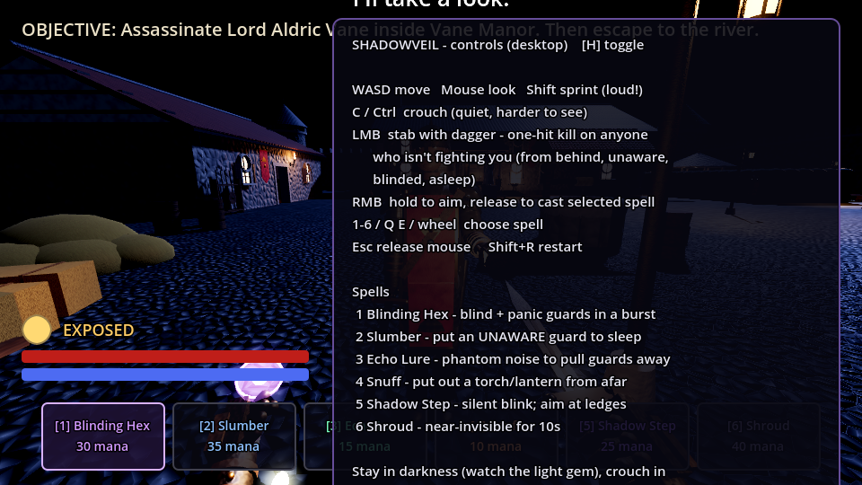
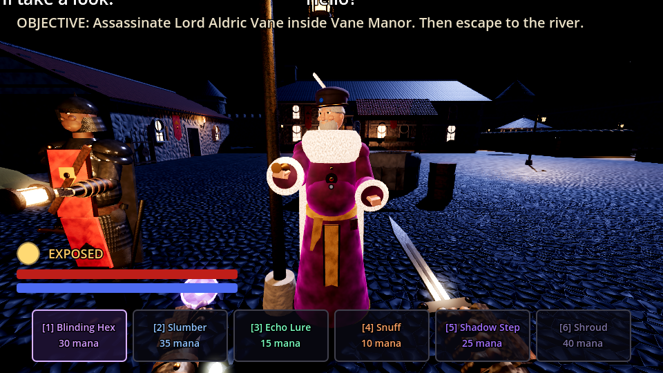
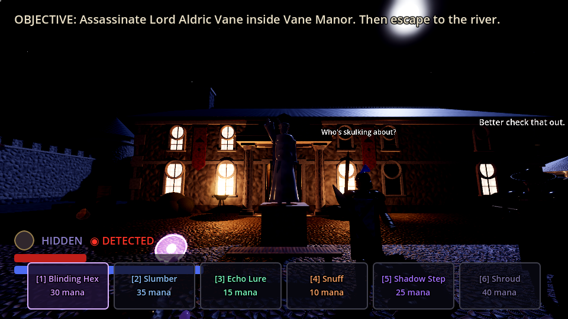
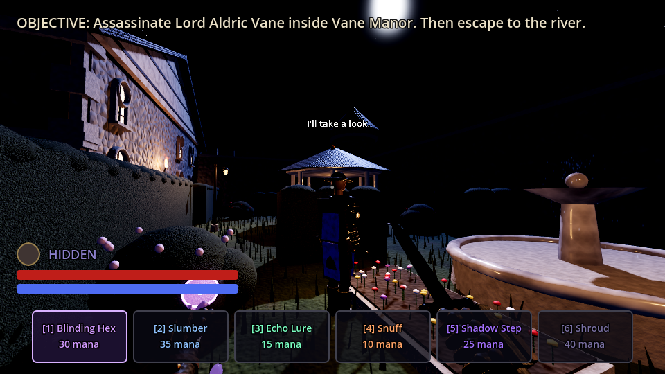

# Shadowveil: a VR stealth assassination game (Godot 4.3)

You are a silent assassin who works with shadow magic. Get into **Vane Manor** at midnight,
kill **Lord Aldric Vane**, and slip away to the river without anyone seeing you.

Everything is generated procedurally at startup: the detailed character models, the PBR
materials and textures, the whole map, the particles and even the sound effects. The project
has no imported art or audio assets.

| | |
|---|---|
|  |  |
|  |  |

*(Screenshots come from the software-rendered Compatibility backend. The real Forward+
renderer adds volumetric fog, SSAO and better shadows.)*

## Running

1. Open the folder in **Godot 4.3+** (standard build; OpenXR is built in).
2. **VR:** start your OpenXR runtime (SteamVR, Oculus/Meta Link, WMR, Monado…) and press Play.
   The game detects the headset automatically.
3. **No headset:** the game falls back to mouse and keyboard. Pass `--desktop` after `--`
   to force this mode even when a headset is connected.

## How stealth works

- **Light is your enemy.** The game measures your visibility from real light sources
  (torches, braziers, lamp posts, candles, chandeliers, guard lanterns, moonlight blocked by
  roofs). Watch the **light gem** on your left wrist (VR) or the HUD gem (desktop).
- **Crouching** (physically, or with the right stick down) makes you harder to see and much
  quieter. You are almost invisible while crouched in **bushes, hay piles and flower bushes**.
- **Sound carries.** Footsteps make noise: sprinting is loud, walking is moderate and
  crouching is nearly silent. Walls muffle sound.
- **Guards** have a vision cone with line-of-sight checks and a close-range "sixth sense".
  Their awareness fills up over time: `?` means suspicious, they investigate, and `!` means
  combat. Once alerted they raise the alarm and other guards come running. Guards who find a
  **body** sound the alarm. Guards who find a **sleeper** wake them up.
- **Sneak attack:** one dagger strike kills anyone who isn't actively fighting you. That
  covers guards hit from behind, unaware guards, blinded guards and sleeping guards. Alerted
  guards that face you will parry, and their armour means it takes 3 hits to kill one. You
  can't win a straight fight, and you aren't meant to.

## Shadow magic (left hand)

Each spell is powerful, but only for stealth:

| # | Spell | Mana | Effect |
|---|-------|------|--------|
| 1 | **Blinding Hex** | 30 | A burst of searing shadow-light. Every guard in the burst goes blind and **panics**: they claw at their eyes and stumble around screaming. The scream draws other guards to *them*, not to you. Blind guards can be killed face to face. |
| 2 | **Slumber** | 35 | Puts an **unaware** mind into deep sleep for 40 s. It **fails on alerted guards**. A sleeper can be killed or left alone, but another guard may wake them. |
| 3 | **Echo Lure** | 15 | Throws a phantom clatter of pots and pans. Nearby guards go to investigate the spot. |
| 4 | **Snuff** | 10 | Puts out a torch, brazier, candle or lamp that you point at, so you can make your own shadows. |
| 5 | **Shadow Step** | 25 | A silent blink of up to 13 m. Aim at the top edge of a wall to mount ledges, roofs and the stable rooftop. |
| 6 | **Shroud** | 40 | Living darkness makes you nearly invisible for 10 s. Attacking breaks it. |

Mana regenerates slowly, and so does health once you are out of combat.

## Controls

### VR (OpenXR default action map)
| Input | Action |
|---|---|
| Left stick | Smooth locomotion (head-relative). Click and hold while moving to sprint. |
| Right stick left/right | Snap turn 40° |
| Right stick down | Toggle crouch (you can also physically crouch) |
| **Swing your right hand** | Strike with the dagger. Stab or slash fast enough to hit. |
| Right trigger | Strike assist when the blade is already touching a target |
| Left trigger (half / full) | Aim the spell (shows a beam and target marker) / cast |
| Left Y/B · X/A | Next / previous spell |
| Left menu | Show the objective. After the mission ends: restart |

The **left wrist** shows the current spell, a mana bar, a health bar and the light gem.
Haptics pulse on kills, on hits and with your heartbeat as guards grow suspicious.

### Desktop
| Key | Action |
|---|---|
| WASD / mouse | Move / look |
| Shift | Sprint (loud!) |
| C or Ctrl | Toggle crouch |
| LMB | Dagger stab |
| RMB (hold → release) | Aim → cast the selected spell |
| 1–6, Q/E, mouse wheel | Select spell |
| H | Show or hide help · Esc releases the mouse · R restarts after the mission ends (Shift+R any time) |

## The test map: Vane Manor

- **South forest:** this is where you start, at a small camp. Pines, rocks and bushes give
  cover. A road runs to the lit **gatehouse**, which two guards watch. The **extraction**
  point is the blue spirit-light on the dock by the river.
- **Collapsed breach** in the south-west wall: the quiet way in.
- **Courtyard:** a well, market stalls, carts, crates, hay, archery butts, a statue of the
  lord and pools of lamp light with dark gaps between them. Two guards patrol here, one with
  a **lantern that lights you up**.
- **Barracks (west):** bunks, a dice table and a weapon rack. One guard sleeps off his watch
  and another wanders in and out.
- **Vane Manor (north):** the great hall has a throne dais, a long feast table, a fireplace,
  a chandelier, pillars, suits of armour and banners. Next to it is the lord's **study**,
  with a desk, bookshelves and a globe. The front door is guarded and lit by braziers. There
  is a **side door to the garden**.
- **Hedge garden (east):** hedges, a gazebo, a fountain, rose bushes and flower beds, patrolled
  by a guard with a lantern.
- **Stable (south-east):** hay piles to hide in, and a **flat roof** you can Shadow Step onto.

**Lord Vane** follows a routine. He holds court at his throne, reads at his study desk,
then walks out of the side door to the gazebo and the fountain before he returns. **Captain
Roderick** shadows him. If the alarm goes up, the lord runs and cowers in his study.

Your end rating depends on alarms, bodies and kills. Kill only the lord, with no alarms, to
earn **SILENT ASSASSIN**.

## Project layout

```
scenes/main.tscn                 entry scene (everything else is built in code)
scripts/main.gd                  XR / desktop bootstrap
scripts/autoload/game_state.gd   noise bus, alarm, light-level queries, objectives, stats
scripts/autoload/sfx.gd          procedural audio synthesis (all SFX + ambience)
scripts/util/mats.gd             procedural PBR materials (noise-generated albedo/normal maps)
scripts/util/geo.gd              primitive-mesh + collision helpers
scripts/npc/humanoid.gd          detailed procedural humanoid model + procedural animation
scripts/npc/guard.gd             guard/target AI (perception, hearing, states, combat)
scripts/player/player.gd         VR + desktop player, dagger, spells, stealth metrics
scripts/player/hand_models.gd    gloved hands, dagger, casting orb, wrist display
scripts/magic/spell_projectile.gd
scripts/world/level_builder.gd   the map, lighting, NPC roster, navmesh
scripts/world/props.gd           40+ detailed prop builders
scripts/world/light_source.gd    flickering, snuffable lights
scripts/fx/fx.gd                 particles: blood, smoke, magic bursts
shaders/night_sky.gdshader       starfield + moon sky
tests/                           headless smoke test, patrol soak test, screenshot rig
```

## Tests

```bash
# Gameplay smoke test: patrols, detection, sneak kills, every spell, the live stab
# and projectile paths, and mission completion.
godot --headless --fixed-fps 60 --path . res://tests/smoke_test.tscn -- --desktop

# 2-minute patrol soak test (reports any guard that gets stuck on geometry)
godot --headless --fixed-fps 60 --path . res://tests/patrol_test.tscn -- --desktop

# Review screenshots (needs a display or xvfb-run)
godot --path . res://tests/screenshots.tscn -- --desktop --out=/tmp/shots
```

## Performance notes

The game targets PC VR with the Forward+ renderer. Volumetric fog is turned off
automatically in VR to keep frame times low. To run on standalone Quest, switch the
renderer to Mobile and lower the number of shadow-casting lights in `level_builder.gd`.
